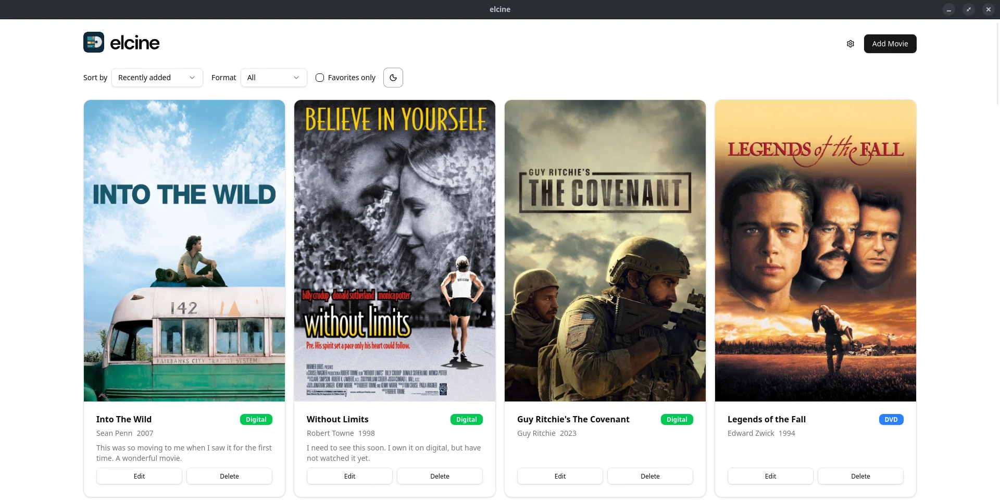

<p>
  <picture>
    <source media="(prefers-color-scheme: dark)" srcset="docs/brand/elcine-banner-dark-readme.svg">
    
  </picture>
</p>

> **Pronunciation:** *el SEE-neh* (/el ˈsi.ne/), like the Spanish *el cine*, "the cinema".

A desktop app for logging the movies you own. 

Built with Tauri 2, React 19 and an embedded Turso database. Everything stays local.

<picture>
  <source media="(prefers-color-scheme: dark)" srcset="docs/screenshots/grid-dark.webp">
  
</picture>

## Features

- Add movies with title, format (DVD / Digital / Blu-ray), notes and a favorite flag
- Director, release year and poster are filled in automatically from [TMDB](https://www.themoviedb.org/)
- Posters are cached locally, so the collection works offline
- Poster grid with a detail view; sort by date added, title, director or release year
- Filter by format or favorites; light/dark theme
- TMDB key entered in-app (Settings), prompted on first launch

## TMDB key

On first launch, elcine asks for a free [TMDB API key](https://www.themoviedb.org/settings/api) (the "API Key", not the read access token). You can change it later via the gear icon.

## Install (Linux)

Download from [Releases](https://github.com/papadavis47/elcine/releases/latest):

- **Debian/Ubuntu/Pop!_OS:** `sudo apt install ./elcine_*_amd64.deb` (adds `elcine` to PATH and app launcher)
- **Other distros:** AppImage: `chmod +x elcine_*_amd64.AppImage && ./elcine_*_amd64.AppImage`

## Build from source

Requires Node + pnpm, Rust, and the [Tauri prerequisites](https://tauri.app/start/prerequisites/).

```bash
pnpm install
pnpm tauri dev
```

Install as a desktop app (Debian/Ubuntu/Pop!_OS): adds `elcine` to your PATH and app launcher.

```bash
pnpm tauri build --bundles deb
sudo apt install ./src-tauri/target/release/bundle/deb/elcine_*_amd64.deb
```

For development you can skip the prompt by putting `TMDB_API_KEY=...` in `src-tauri/.env`; a key saved in the app takes precedence.

## Commands

```bash
pnpm tauri dev      # run the app
pnpm tauri build    # build a desktop bundle
pnpm test           # frontend tests (Vitest)
cd src-tauri && cargo test   # backend tests
```

## Data

On Linux the database and poster cache live in `~/.local/share/io.github.papadavis47.elcine/`. Dev builds (`pnpm tauri dev`) use the `dev/` subfolder, so they never touch your installed collection.

## License

[MIT](LICENSE). Bundled fonts in `docs/brand/fonts/` are under the SIL Open Font License (see the OFL files there).

Movie poster images (in the screenshots and those fetched from TMDB) are the property of their respective copyright holders and are shown for illustration only; they are not covered by the MIT license.

---

This product uses the TMDB API but is not endorsed or certified by TMDB.
